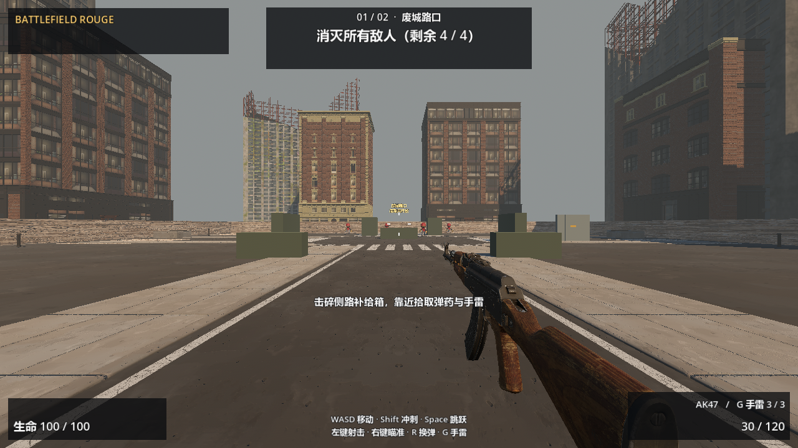
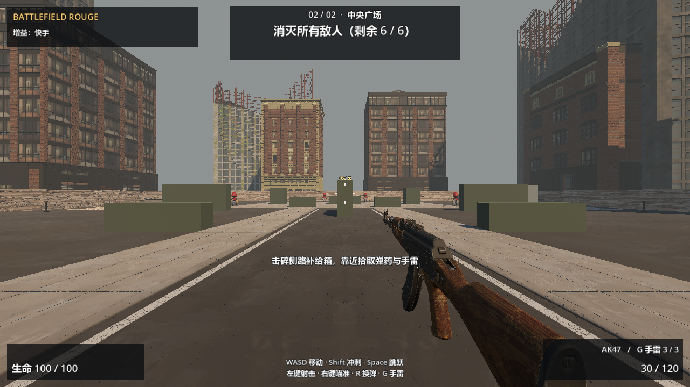

# Battlefield Rouge

Godot 4.7.2 第一人称战区射击肉鸽原型。清空敌人、占领据点、选择局内强化，推进到下一战区；阵亡后清空本局增益。工程使用 Forward+ 渲染与 Jolt 物理。

[GitHub 仓库](https://github.com/KADG777/Battlefield_Rouge)

## 运行

1. 安装 **Godot 4.7.2 标准版**。
2. 下载或克隆本仓库，在 Godot 项目管理器中导入根目录 `project.godot`。
3. 首次打开等待素材导入完成，按 **F5** 运行。

也可先克隆仓库：

```sh
git clone https://github.com/KADG777/Battlefield_Rouge.git
cd Battlefield_Rouge
```

Windows 可选启动脚本会优先使用环境变量 `GODOT_EXE` 指定的引擎，再查找 PATH 中的 `godot`。不使用脚本也可以直接在编辑器中运行。

## 操作与流程

| 操作 | 按键 |
| --- | --- |
| 移动／冲刺／跳跃 | WASD／Shift／Space |
| 射击／瞄准／换弹 | 鼠标左键／鼠标右键／R |
| 手雷 | G |
| 释放鼠标 | Esc；点击游戏重新捕获 |
| 选择强化 | 1–3 或点击选项 |
| 阵亡或胜利后重新开始 | R 或界面按钮 |

每个战区先清敌，再站在据点圆圈内 **6 秒**完成占领。战区1之后三选一强化，战区2占领后胜利。当前保留4／6名敌人、60米战斗区域与六种原有增益。

## 六项素材接入

| 资源 | 当前用途 |
| --- | --- |
| Majadroid 城市废墟 | 外围四种废墟塔楼，增加远景层次 |
| Quaternius Downtown City MegaKit **免费 Standard** | 近景建筑、城市路口、街道与中央广场细节；未包含付费 Source |
| Poly Haven Rubble | 1K颜色、GL法线、粗糙度，补充地面与墙脚细节 |
| Stein Classic Weapons | 玩家近景AK47；保留原射击、换弹、ADS与Stats通路，无新增手臂骨骼动画 |
| PYROLUX Lite，可选且不随仓库分发 | 可自行取得后启用火焰爆炸；默认使用项目自写的基础闪光、烟雾与合成音效 |
| Jummit Godot Destruction Plugin | 补给箱与侧路薄墙的刚体分块、碰撞及限时回收 |

每区初始3枚手雷，1.4秒引信、5米爆炸范围，实体墙可遮挡伤害。补给箱40耐久／8片，薄墙100耐久／12片；碎片3秒回收，不阻挡角色或子弹，破坏后更新导航。击碎补给箱后靠近绿色补给包，获得30后备弹（上限180）与1枚手雷（上限3）；物资全满时保留补给。

## 实机画面

城市路口：



中央广场：



## 验证

2026-10-24，**本公开副本在未安装PYROLUX的情况下通过 92／92 项原生功能回归，0失败**。使用项目自写基础爆炸，覆盖实际武器射线、手雷、碎片、补给、导航、清敌、占点、强化、阵亡重开和两区胜利；同时检查了备用爆炸的真实几何、动画、限量与回收。导入和最终运行日志无错误或警告。

自动化入口为 `tools/verify_integration.gd`，会根据可选插件是否存在检查对应效果。先导入，再使用实际渲染运行；测试输出保存在本机被忽略的 `verification/`：

```sh
godot --headless --editor --path . --import
godot --path . --script res://tools/verify_integration.gd
```

公开结果见 [docs/VALIDATION.md](docs/VALIDATION.md) 与 [验证摘要](docs/validation-summary.json)。这是自动功能回归与画面检查，未代表真人整局难度平衡或大型城市破坏性能评估。

## 协作与许可

此为新公开分发副本，后续修改按 **分支 → Pull Request → 审查 → 合并**流程进行。开始前阅读 [AGENTS.md](AGENTS.md)、[ARCHITECTURE.md](ARCHITECTURE.md)、[GLOSSARY.md](GLOSSARY.md) 和 [COLLABORATE.md](COLLABORATE.md)。

地图必须修改 `tools/gen_zones.py` 后重新生成，不能直接编辑生成的 `maps/zone_*.tscn`。城市布景在 `zone/city_dressing.gd`；破坏与补给由战区控制组织，组件不读写局内状态。

第三方素材按各自许可使用，来源、版本和哈希见 [docs/ASSETS.md](docs/ASSETS.md)、[素材清单](docs/asset_manifest_20261024.json) 与 [THIRD_PARTY_NOTICES.md](THIRD_PARTY_NOTICES.md)。本仓库未将素材许可扩大为全部自有代码的统一新许可。

`addons/pyrolux_fx/`、原始下载压缩包、引擎缓存与本机日志不随仓库发布。需要可选PYROLUX时，请从[原作者页面](https://gennai.itch.io/pyrolux-lite)自行取得并遵守其许可；不安装也能运行游戏。
